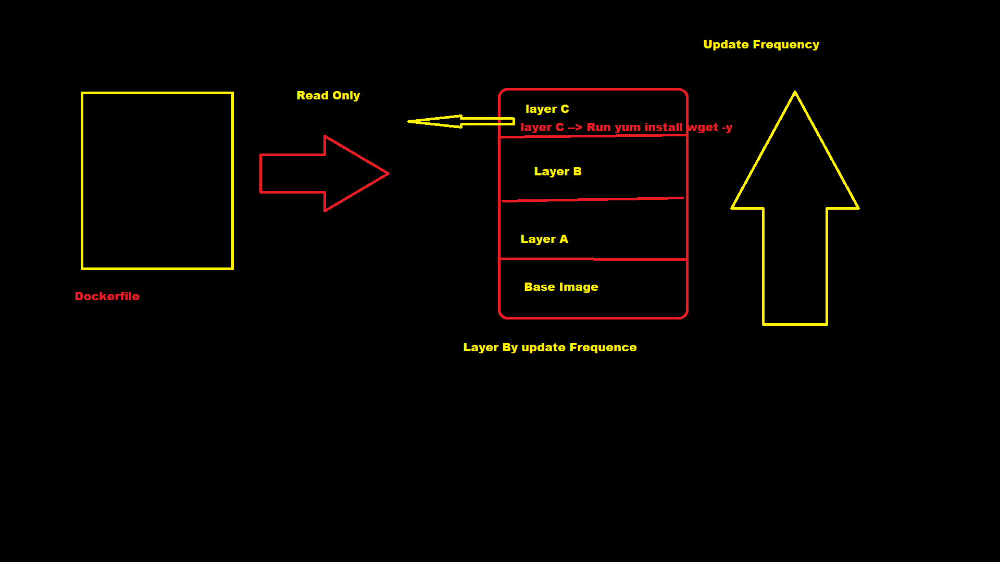

# 04. Understanding and Creating a Dockerfile

## 1. Docker Image

- A Docker image is a non-writable (read-only) file.
- Docker images are pre-built and can be downloaded from:
  - The internet
  - Docker Hub
- We can also create our own Docker image using a Dockerfile.

```bash
docker image pull <image-name>
docker pull <image-name>
```
→ Docker first checks locally; if the image is not found, it downloads it from Docker Hub.

```bash
docker run hello-world
docker run alpine
```
→ Docker first checks locally; if the image is not found, it downloads the image and then creates the container.

## 2. Workflow

1. A **Dockerfile** is used to create a Docker image.
2. Write the instructions inside the Dockerfile.
3. Build a Docker image from the Dockerfile; this image is then used to run the container.

## 3. Dockerfile Syntax

| Instruction | Purpose |
|---|---|
| `FROM` | Defines the base image |
| `RUN` | Executes commands while the image is being built |

## 4. Building a Docker Image

```bash
docker build -t <image-name> .
```

- `build` → creates an image from the Dockerfile
- `-t` → tag (assigns a name to the image)

## 5. Dockerfile Examples

### Example 1

```dockerfile
FROM alpine
RUN echo "Hello from dockerfile"
RUN echo $(pwd)
RUN touch file.txt
```

```console
[root@localhost lec5]# vim Dockerfile
[root@localhost lec5]# cat Dockerfile
FROM alpine
RUN echo "Hello from dockerfile"
RUN echo $(pwd)
RUN touch file.txt

[root@localhost lec5]# docker images
IMAGE            ID             DISK USAGE   CONTENT SIZE   EXTRA
busybox:latest   1487d0af5f52        6.7MB         2.22MB    U

[root@localhost lec5]# docker build .
[+] Building 9.0s (8/8) FINISHED                                                     docker:default
 => [internal] load build definition from Dockerfile                                           0.0s
 => => transferring dockerfile: 176B                                                           0.0s
 => [internal] load metadata for docker.io/library/alpine:latest                               2.9s
 => [internal] load .dockerignore                                                              0.0s
 => => transferring context: 2B                                                                0.0s
 => [1/4] FROM docker.io/library/alpine:latest@sha256:25109184c71bdad752c8312a8623239686a9a2071e8825f20acb8f2198c3f659   4.1s
 => => resolve docker.io/library/alpine:latest@sha256:25109184c71bdad752c8312a8623239686a9a2071e8825f20acb8f2198c3f659   0.0s
 => => sha256:589002ba0eaed121a1dbf42f6648f29e5be55d5c8a6ee0f8eaa0285cc21ac153 3.86MB / 3.86MB 3.9s
 => => extracting sha256:589002ba0eaed121a1dbf42f6648f29e5be55d5c8a6ee0f8eaa0285cc21ac153      0.1s
 => [2/4] RUN echo "Hello from dockerfile"                                                     0.4s
 => [3/4] RUN echo $(pwd)                                                                      0.4s
 => [4/4] RUN touch file.txt                                                                   0.4s
 => exporting to image                                                                         0.6s
 => => exporting layers                                                                        0.2s
 => => exporting manifest sha256:cc4d24a147a56fcfb3b8243dc9c246e5b638441c0146839db3145c1c6a44a3bc              0.0s
 => => exporting config sha256:ae6f205b096c724855dc8ab2bb044dc4ed5809cecffa8995dbde37156e3f2f2c                0.0s
 => => exporting attestation manifest sha256:46cfc6119a5748074d8e1e26415f7a76d3f75a9cad6780413b9d960bf5b7d2bf  0.0s
 => => exporting manifest list sha256:e0417a98ca3a4dcae81b053515b3dd9e3211f1229aed9814d18b0b4a93d8a325         0.0s
 => => naming to moby-dangling@sha256:e0417a98ca3a4dcae81b053515b3dd9e3211f1229aed9814d18b0b4a93d8a325         0.0s
 => => unpacking to moby-dangling@sha256:e0417a98ca3a4dcae81b053515b3dd9e3211f1229aed9814d18b0b4a93d8a325
```

### Example 2

```dockerfile
FROM alpine
RUN echo "Hello from dockerfile"
RUN echo $(pwd)
RUN touch file.txt
RUN cd /tmp && touch sample.txt
```

## 6. Image Layers



## 7. Important Questions

**Q1. How many layers will be created?**

- Each `RUN` instruction creates a new layer.
- Multiple layers will be created (one per `RUN` command).

**Q2. Will the image ID stay the same?**

- No. The image ID changes whenever the instructions change.

## 8. Interview Question

**Q. If you want to reduce the number of image layers while building a Docker image, what will you do?**

Use `&&` (the AND operator) to combine commands into a single `RUN` instruction.

```dockerfile
RUN echo "Hello" && touch file.txt && cd /tmp && touch sample.txt
```

## 9. Versioning Concept

- Images can have versions, such as `webimage:v1`, `webimage:v2`, `webimage:v3`, `webimage:v4`.
- Docker itself also follows versioning, e.g. Docker version 20, Docker version 21.
