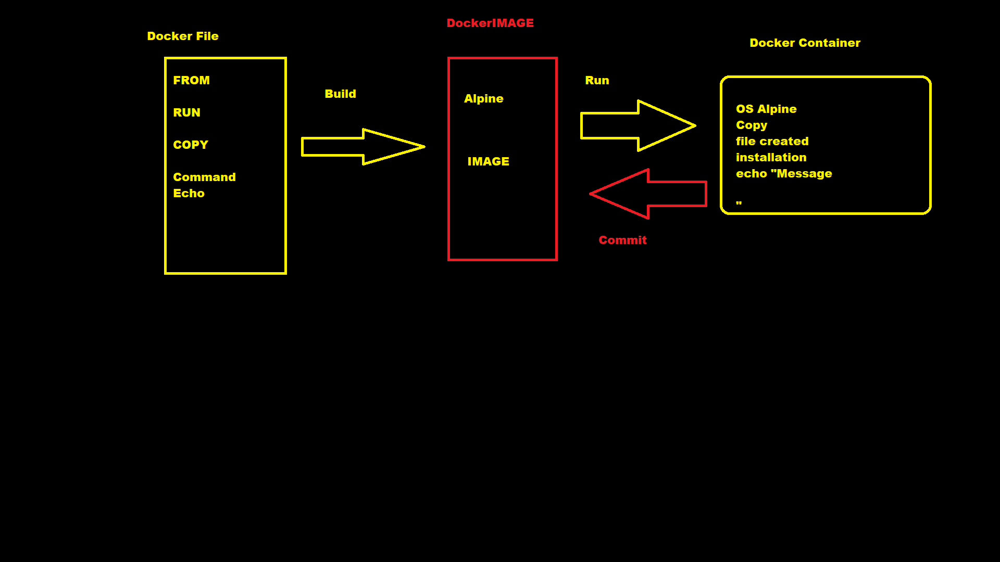
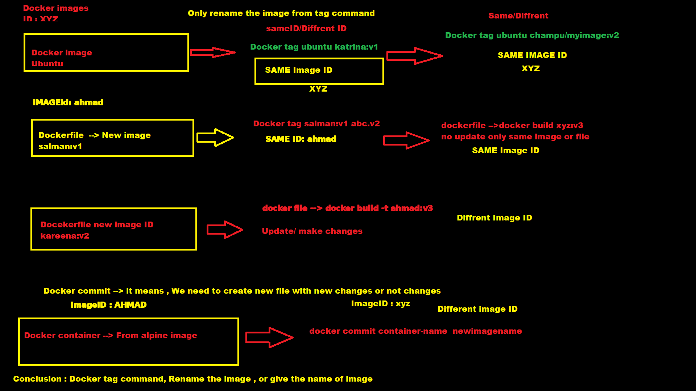

# 06. Creating a Docker Image from a Container

## 1. Docker Commit

`docker commit` is used to create a Docker image from a container.

```bash
docker commit <old-container> <new-image:tag>
```



## 2. Questions

**Q1. If we take an Ubuntu image, create a container, and the container exits, can we still run `docker commit`?**

Yes. `docker commit` can be run on a stopped container as well.

**Q2. Will the image ID be the same (the Ubuntu image ID vs the new image created with `docker commit`)?**

```bash
docker run --name ali alpine
```

| Item | ID |
|---|---|
| Container ID | `cfebc166741b` |
| Alpine image ID | `e9adb5357e84` |
| Committed image ID | `01348df28fbc` |

No, the image ID will be different.

**Q3. If we create two containers (`cont1` and `cont2`) from the same Alpine image and then commit both (`cont1` → `image1`, `cont2` → `image2`), will `image1` and `image2` have the same image ID?**

No, both will have different image IDs.



## 3. Docker Build and Dangling Images

```bash
docker build .
```
- Builds or updates an image from a Dockerfile.
- A new image ID is generated after the build.

### Dangling images

Images that have:
- No repository name
- No tag (shown as `<none>`)
- Only an image ID

are called **dangling images**.

**Find dangling images:**
```bash
docker images --filter "dangling=true"
```

## 4. Remove Commands

**Remove all containers:**
```bash
docker rm $(docker ps -a -q)
```

**Remove all images:**
```bash
docker rm $(docker images -q)
```
