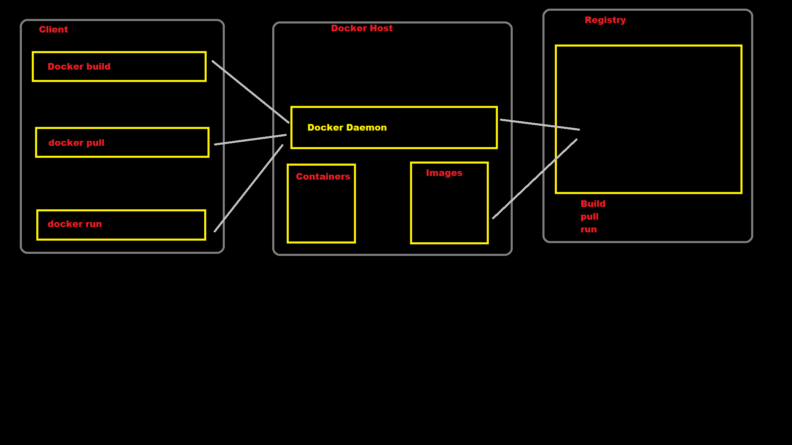
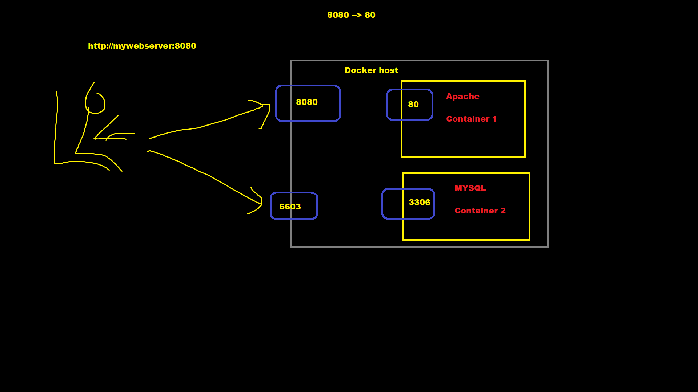

# 07. Docker Daemon, Port Mapping and Conflicts



## 1. Docker Daemon and Socket

```bash
systemctl stop docker.socket
```
- Stops the Docker socket service.

Running `docker ps -a` after stopping it gives this error:

```console
Cannot connect to the Docker daemon at unix:///var/run/docker.sock. Is the docker daemon running?
```

- The Docker CLI communicates with the Docker daemon through a socket file.
- If the daemon or the socket is stopped, Docker commands will not work.

## 2. Running an Nginx Container with Options

```bash
docker run -it -d -p 9000:80 --name mywebserver nginx:latest
```

| Option | Meaning |
|---|---|
| `-it` | Interactive terminal |
| `-d` | Detached mode (runs the container in the background) |
| `-p 9000:80` | Port mapping (host:container) |
| `--name mywebserver` | Assigns a name to the container |
| `nginx:latest` | Image used |

```bash
docker exec -it mywebserver /bin/sh
```
- Opens a shell inside the Nginx container.

## 3. Attach vs Detach Mode

- `-d` (detach): runs the container in the background.
- `-a` (attach): connects the terminal to the container's output.

## 4. Port Mapping Concept



**Without mapping:**
```bash
docker run --name web-NEW nginx
```
- There is no connection between a host port and the container port.
- The application inside the container is not accessible from the host.

**With mapping:**
```bash
docker run --name web-NEW -p 9000:80 nginx
```
- The `-p` flag maps ports.
- Host port `9000` → container port `80`.
- The application becomes accessible from the host.

## 5. Port and Name Conflict Examples

| Command | Runs? | Reason |
|---|---|---|
| `docker run -it -p 80:80 --name web1 nginx` | ✅ Yes | |
| `docker run -it -p 80:80 --name web2 nginx` | ❌ No | Port 80 is already in use |
| `docker run -it -p 8080:80 --name web2 nginx` | ❌ No | Container name conflict (name already used) |
| `docker run -it -p 8080:80 --name web3 nginx` | ✅ Yes | |
| `docker run -it -p 8001:80 --name web4 nginx` | ✅ Yes | |

## 6. Key Learnings

1. **Docker components:**
   - Client
   - Server (daemon)
   - Registry
2. **Docker socket file:**
   - The communication channel between the Docker client and the daemon.
   - Located at `/var/run/docker.sock`.
3. **Docker port mapping:**
   - Required to access container services from the host.
   - Done with the `-p` flag.
4. **Docker conflicts:**
   - Port conflict → the same host port cannot be reused.
   - Name conflict → container names must be unique.

## 7. Homework

1. Study the Docker socket (how it works).
2. Learn Linux networking basics:
   - IP address
   - Subnet
   - iptables
3. Practise Docker push:
   ```bash
   docker push
   ```
