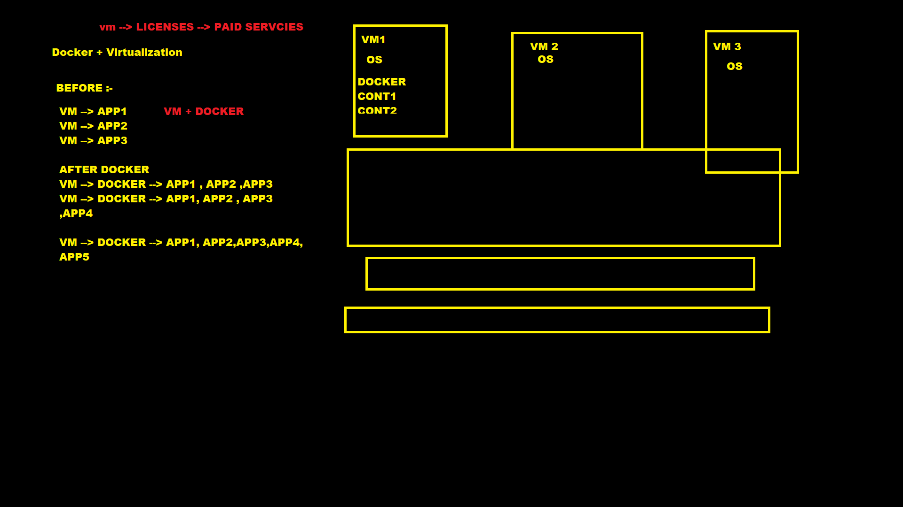
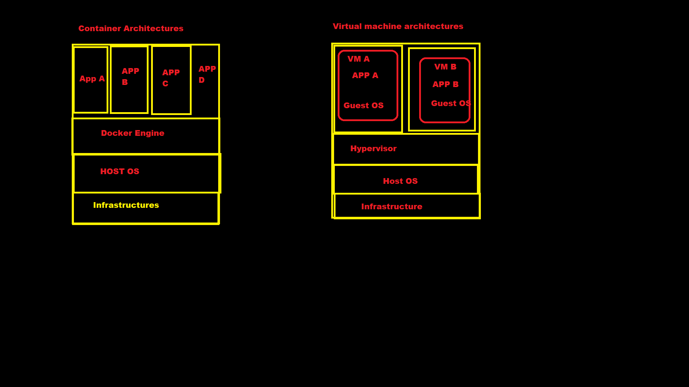

# 08. Deploying an Application in Docker (Node.js Example)

## 1. Why Container Architecture over VMs?

Containers (Docker) are preferred over VMs because they are:
- Lightweight
- More secure
- Easy to use and deploy





## 2. Application Flow (Dockerization)

**App development flow:**
Developer writes code → application is developed → deployment

**Docker flow:**
Dockerfile → Docker image → Docker container

## 3. Core Concepts

**Dockerfile**
- A plain text file.
- Contains a series of instructions.
- Defines:
  - The base OS
  - The application setup
  - The commands to run the app

**Docker image**
- A static artifact built from a Dockerfile.
- Can be tagged and uploaded to Docker Hub.

**Docker container**
- A running instance of a Docker image.

## 4. Conclusion

- Docker images combine:
  - Source code
  - The dependencies required to run the application
- Benefits:
  - Lightweight
  - Portable
  - Easy to share among developers

## 5. Local Development Steps (Without Docker)

1. Get the code from the developer.
2. Install Node.js and the dependencies:
   ```bash
   sudo dnf module enable nodejs:20 -y
   sudo dnf install nodejs -y
   sudo npm install -g nodemon
   npm install express
   npm start
   ```

The application runs locally and opens a port.

## 6. Project Structure

```
nodejs_app/
│
├── package.json
├── src/
│   └── index.js
└── testing/   (for local testing)
```

## 7. Sample Files

**`package.json`**
```console
[root@localhost nodejs_app]# cat package.json
{
  "name": "Ahmad hassan",
  "version": "1.0.0",
  "scripts": {
    "start": "nodemon src/index.js",
    "start:prod": "node src/index.js"
  },
  "dependencies": {
    "express": "^4.17.1"
  },
  "devDependencies": {
    "nodemon": "^2.0.6"
  }
}
```

**`src/index.js`**
```console
[root@localhost src]# cat index.js
const express = require('express');
const app = express();
const port = process.env.PORT || 4000;

app.get('/', (req, res) => {
  res.send("Hello world");
});

app.listen(port, () => {
  console.log(`Example app listening at http://localhost:${port}`);
});
```

## 8. Dockerfile (Production Setup)

Create the Dockerfile inside the `nodejs_app` directory:

```dockerfile
FROM node:15

# Build-time argument
ARG PORT=8000

# Environment variable
ENV PORT=$PORT

# Working directory
WORKDIR /app

# Copy files
COPY src /app/src
COPY package.json /app

# Install dependencies
RUN npm install

# Expose port
EXPOSE $PORT

# Start application
CMD ["npm", "start"]
```

## 9. Build and Run the Docker Container

**Build the Docker image:**
```bash
docker build -t my_node_app .
```

**Run the container:**
```bash
docker run --name my_node_app1 -p 8000:8000 -d my_node_app:latest
```

**Test the application:**
```console
[root@localhost nodejs_app]# curl localhost:8000
Hello world
```

## 10. Useful Commands

| Task | Command |
|---|---|
| Check logs | `docker logs <container-id>` |
| Access the container | `docker exec -it <container-id> /bin/sh` |
| Exit the container without stopping it | `Ctrl + P + Q` |

## 11. Changing the Port with an Environment Variable

**Set the variable:**
```bash
my_port=5000
```

**Run the container:**
```bash
docker run --name my_node_app2 -p 9000:$my_port -d -e PORT=$my_port my_node_app:latest
```
