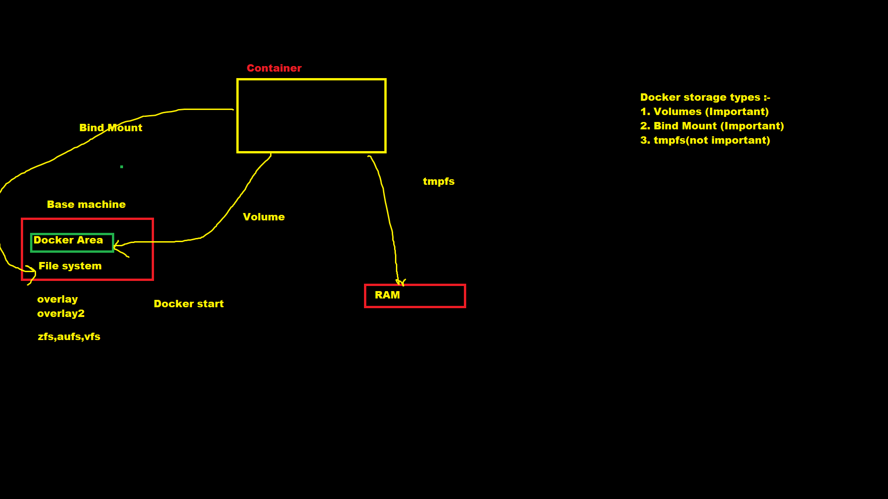

# 11. Introduction to Docker Volumes

## The Problem: Losing Data from Containers

- Data in a container is lost when the container is removed → we need **persistent** storage.
- Whether a container is removed, killed or stopped, you should never lose your data.
- A container runs as a process.
- The solution is **Docker volumes**.

Docker stores data in three ways — two are very important and one is less important.



## Docker Storage Types

1. **Volumes** (important) → `/var/lib/docker`
2. **Bind mounts** (important)
3. **tmpfs** (not important)

| Type | Description |
|---|---|
| **Volume** | Also called a Docker volume. Data is stored in the Docker area on the base machine. |
| **Bind mount** | Also called a Docker bind. Container data is stored in the host file system (e.g. vfs, zfs, overlay, overlay2). |
| **tmpfs** | Data is stored in RAM; it is wiped out when the machine reboots. |

## Docker Area

- Docker area = Docker home = Docker database
- Path: `/var/lib/docker`

| Item | Path |
|---|---|
| Docker volumes | `/var/lib/docker/volumes` |
| Docker image metadata | `/var/lib/docker/image/overlay2/imagedb/metadata/sha256` |

```bash
docker volume ls
```

## Docker Storage in Detail

1. **Docker volumes** — stored on the host file system and managed by Docker. On an Ubuntu system the path is `/var/lib/docker/volumes`.
2. **Bind mounts** — allow storage to be mounted from anywhere on the host system, for example `/home/aadmin/data`. You could even mount `/data`.

   ```
   /home/aadmin/data  →  changes happen here
   /data              →  changes are replicated here
   ```
